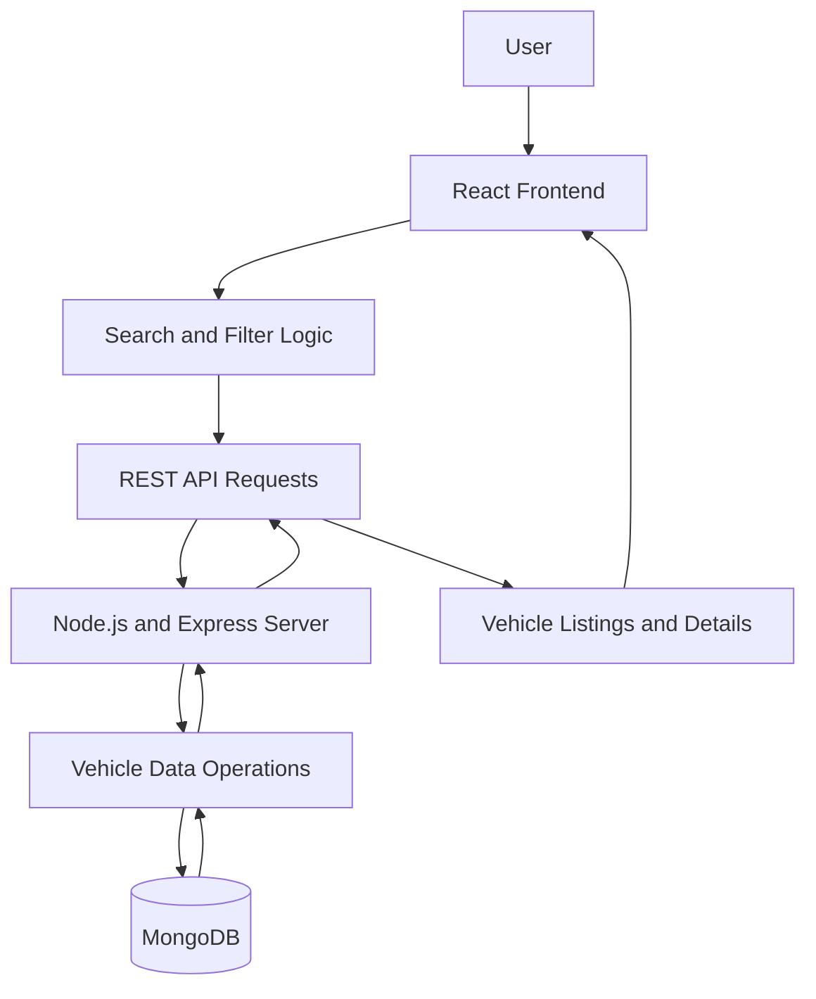

# Car Showcase — Full-Stack Vehicle Discovery Platform

**A modern MERN stack application for exploring, searching, filtering, and comparing cars through a responsive and user-friendly interface.**

Car Showcase is a full-stack web application designed to simplify vehicle discovery by bringing car listings, specifications, pricing, and comparison features into one platform. Built with React, Node.js, Express.js, and MongoDB, the application combines a dynamic frontend with RESTful APIs and a scalable backend architecture.

The project focuses on making vehicle research more convenient through structured vehicle information, interactive search and filtering, reusable UI components, and efficient data management.

[](https://react.dev/)
[](https://nodejs.org/)
[](https://expressjs.com/)
[](https://www.mongodb.com/)
[](https://developer.mozilla.org/en-US/docs/Web/JavaScript)

## Table of Contents

- [Overview](#overview)
- [Key Features](#key-features)
- [Technology Stack](#technology-stack)
- [System Architecture](#system-architecture)
- [Application Workflow](#application-workflow)
- [Getting Started](#getting-started)
- [Environment Configuration](#environment-configuration)
- [API Architecture](#api-architecture)
- [AI Integration Opportunities](#ai-integration-opportunities)
- [Future Improvements](#future-improvements)
- [Contributing](#contributing)
- [License](#license)

## Overview

Finding the right car often involves navigating multiple listings, comparing technical specifications, checking prices, and evaluating different manufacturers and vehicle types.

Car Showcase provides a centralized interface for browsing vehicle information and narrowing down options using relevant attributes.

The application follows a full-stack architecture in which React manages the user interface, Express.js and Node.js handle backend operations, and MongoDB provides persistent data storage.

### Project Goals

- Build a responsive and intuitive vehicle discovery experience.
- Enable dynamic car search and filtering.
- Present specifications and pricing in a structured format.
- Support vehicle comparison to simplify purchase research.
- Separate frontend and backend responsibilities through RESTful APIs.
- Maintain reusable components and an extensible application architecture.

## Key Features

### Vehicle Listings

- Browse available vehicle listings through a structured interface.
- Present relevant information such as manufacturer, model, pricing, and specifications.
- Organize vehicle data to make browsing and discovery more convenient.

### Dynamic Search and Filtering

- Search for vehicles based on relevant attributes.
- Filter results using criteria such as manufacturer, fuel type, transmission, and price.
- Narrow down vehicle choices without manually reviewing every listing.

### Vehicle Comparison

- Compare vehicle specifications and pricing to understand differences between models.
- Evaluate relevant attributes side by side when choosing between alternatives.

### Responsive User Interface

- Built with React and reusable UI components.
- Organized vehicle cards and information layouts.
- Designed to support a consistent browsing experience across different screen sizes.

### RESTful Backend

- Node.js and Express.js provide the backend application layer.
- REST APIs connect the frontend to vehicle data and application logic.
- A modular backend structure supports future feature expansion.

### Database Integration

- MongoDB stores structured vehicle information.
- Database-backed data management supports vehicle retrieval and application growth.

## Technology Stack

| Technology | Purpose |
|---|---|
| React | Interactive frontend and reusable components |
| JavaScript | Application logic and dynamic functionality |
| Node.js | Server-side JavaScript runtime |
| Express.js | REST API and backend routing |
| MongoDB | Persistent vehicle data storage |
| REST APIs | Communication between frontend and backend |
| CSS / UI styling | Responsive layouts and visual presentation |

## System Architecture



### Architecture Responsibilities

- **Frontend:** Renders vehicle listings, search controls, filters, and comparison interfaces.
- **Backend:** Handles API requests, validates inputs, and coordinates data operations.
- **Database:** Persists vehicle records and supplies data to the backend.
- **API layer:** Defines the communication boundary between the frontend and backend.

## Application Workflow

1. **Browse:** The user opens the application and explores available vehicle listings.
2. **Search:** The user searches for a particular car or manufacturer.
3. **Filter:** Additional criteria narrow down the available results.
4. **Inspect:** The user reviews the price, specifications, fuel type, transmission, and other attributes.
5. **Compare:** Relevant vehicles can be evaluated against one another.
6. **Retrieve data:** The frontend communicates with the backend to obtain vehicle information from the database.

## Getting Started

### Prerequisites

Install the following before running the application:

- Node.js and npm.
- MongoDB locally or a MongoDB connection string.
- Git.

### 1. Clone the Repository

```bash
git clone https://github.com/bhavyaupreti05/Car_Showcase.git
cd Car_Showcase
```

### 2. Install Dependencies

Install the root dependencies if the root `package.json` defines them:

```bash
npm install
```

If the frontend and backend maintain separate `package.json` files, install dependencies in each application directory as well.

```bash
cd frontend
npm install
```

Then install the backend dependencies:

```bash
cd ../backend
npm install
```

Return to the project root when finished.

### 3. Configure Environment Variables

Create a `.env` file in the backend directory if that is where the server loads its configuration.

Example:

```env
PORT=5000
MONGODB_URI=your_mongodb_connection_string
```

Use the exact variable names expected by the existing backend. Add any frontend environment variables required by your configuration.

**Important:** Never commit `.env` files, database credentials, or API keys to GitHub.

### 4. Start the Backend

From the backend directory, use the start command defined in its `package.json`. A typical development command may look like:

```bash
npm run dev
```

If the project does not define a `dev` script, use its configured start script instead.

### 5. Start the Frontend

Open a separate terminal:

```bash
cd frontend
npm run dev
```

The local frontend URL will be displayed in the terminal. Vite commonly uses `http://localhost:5173`, but the configured port may differ.

If the frontend uses a different build tool, follow the scripts defined in its `package.json`.

## API Architecture

The Express backend provides the application layer for vehicle data and frontend communication.

Depending on the routes implemented in the repository, the API can support operations such as:

| Operation | Purpose |
|---|---|
| Retrieve vehicles | Fetch vehicle listings |
| Search vehicles | Find cars matching a query |
| Filter vehicles | Narrow results using vehicle attributes |
| Retrieve vehicle details | Access information for an individual car |
| Compare vehicles | Supply data for side-by-side comparison |

These describe API capabilities rather than verified endpoint names. Refer to the actual Express route definitions for implemented URLs, HTTP methods, query parameters, and response schemas.

## AI Integration Opportunities

Car Showcase can be extended into an AI-assisted vehicle discovery platform.

Potential enhancements include:

- **Natural-language car search:** Find vehicles using requests such as “Show me fuel-efficient cars under ₹10 lakh.”
- **Personalized recommendations:** Rank vehicles based on budget, preferred features, and user requirements.
- **AI-powered comparisons:** Generate concise explanations of the differences between selected vehicles.
- **Conversational vehicle assistant:** Answer questions about a particular car using its stored specifications.
- **Ownership-cost insights:** Explain estimated running costs and maintenance considerations using reliable input data.

These are extension ideas, not claims that the features are already implemented. An AI integration would require suitable model access, backend integration, and validation of generated recommendations.

## Future Improvements

- AI-powered search and personalized recommendations.
- Advanced filtering and sorting options.
- Improved vehicle comparison with structured specification tables.
- Pagination and optimized database queries for larger datasets.
- Authentication and personalized saved-car lists.
- Automated backend and frontend testing.
- Deployment with environment-specific configuration.
- Improved loading, empty, and error states.
- Performance monitoring and API documentation.

## Contributing

Contributions and suggestions are welcome.

1. Fork the repository.
2. Create a feature branch.
3. Implement and test your changes.
4. Submit a pull request describing the improvement.

## License

A license has not been specified in this README. Add a `LICENSE` file and update this section according to the license chosen for the project.

---

**Built with React, Node.js, Express.js, and MongoDB.**

[View the Car Showcase repository](https://github.com/bhavyaupreti05/Car_Showcase)
